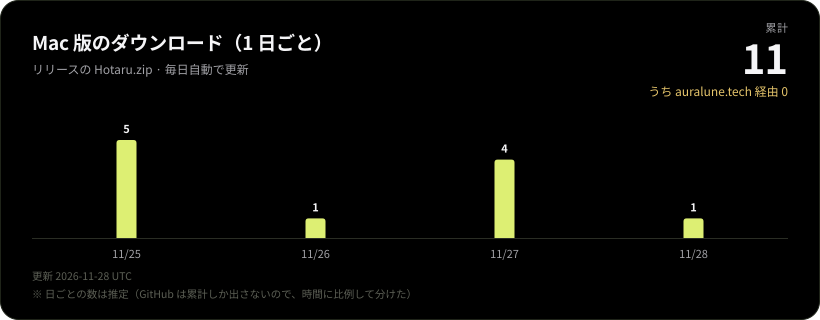
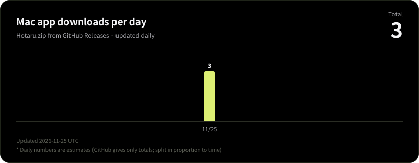

# Hotaru for Mac

  

複数の Mac で動いている AI（Claude Code・Codex・Ollama など）の進み具合を、ひとつの一覧で。
Mac 版は無料で、すべての機能が使えます。iPhone・iPad 版は App Store から。

**ダウンロード：[Hotaru.zip（最新版）](https://github.com/Rhizobium-gits/hotaru-mac/releases/latest/download/Hotaru.zip)**　・　紹介ページ：https://hotaru-ai.vercel.app

## 入れ方

1. Hotaru.zip を開き、出てきた「Hotaru」を「アプリケーション」フォルダへ移します。
2. 開きます。「開けません」と出たら、システム設定 › プライバシーとセキュリティ の下のほうにある「Hotaru」の「このまま開く」を押します（最初の 1 回だけ）。
3. メニューバーの ✦ から使います。新しい版が出ると、アプリの中から 1 回押すだけで更新できます。

動作環境：macOS 14 以降（Apple シリコン・Intel）。

## ダウンロード数

---

# Hotaru for Mac (English)

See the progress of the AI (Claude Code, Codex, Ollama and more) running on all your Macs in one list.
The Mac app is free with every feature. The iPhone and iPad app is on the App Store.

**Download: [Hotaru.zip (latest)](https://github.com/Rhizobium-gits/hotaru-mac/releases/latest/download/Hotaru.zip)** · Website: https://hotaru-ai.vercel.app

1. Open Hotaru.zip and move Hotaru to your Applications folder.
2. Open it. If macOS says it can't be opened, go to System Settings › Privacy & Security and click "Open Anyway" next to Hotaru (first launch only).
3. Use it from the ✦ in the menu bar. New versions can be installed from inside the app with one click.

Requires macOS 14 or later.

## Downloads

